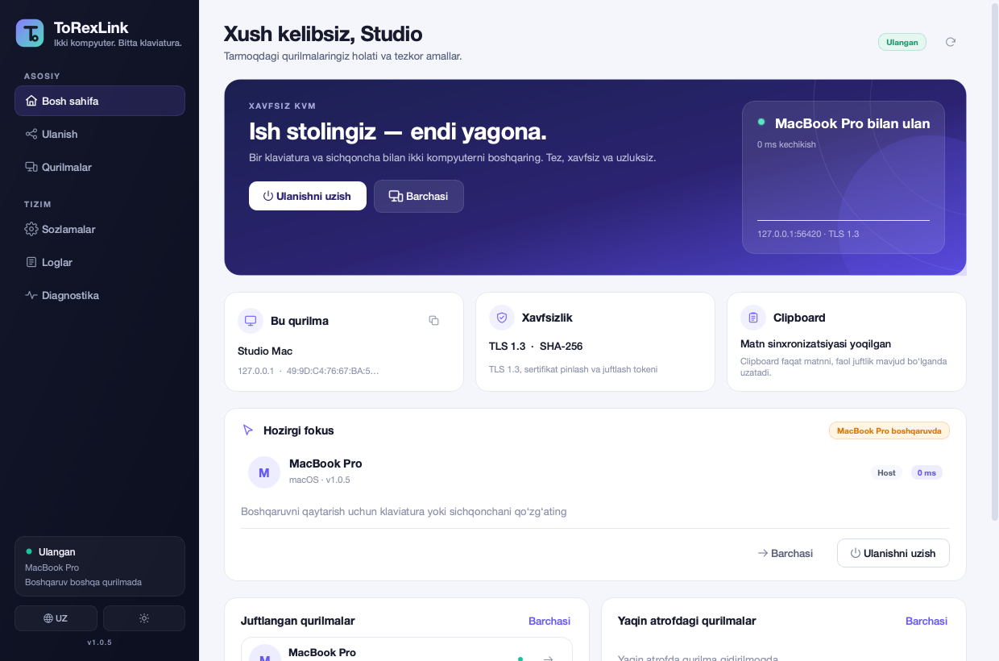
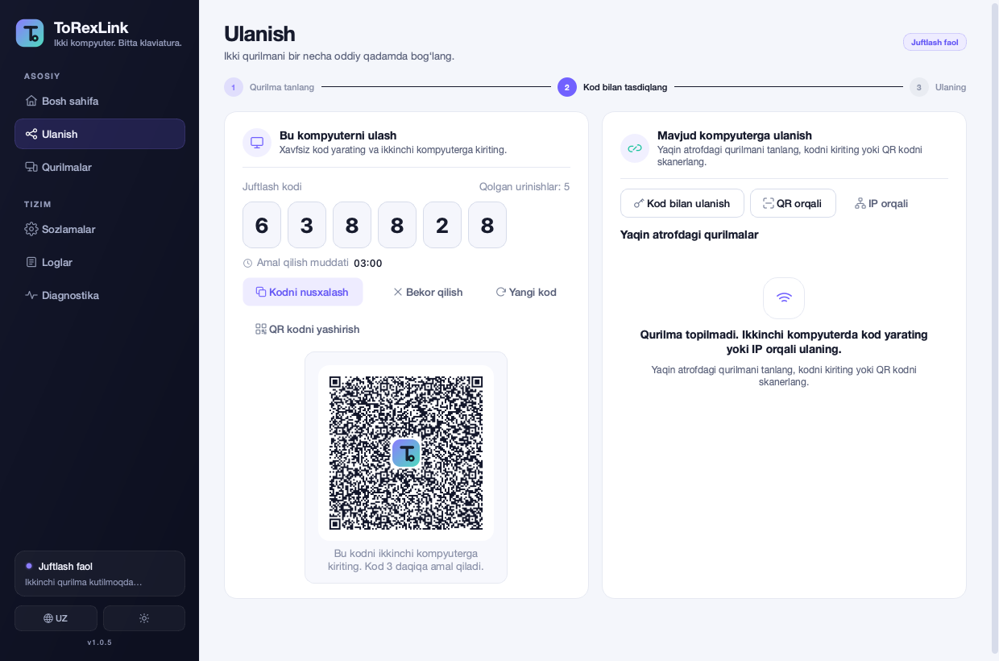
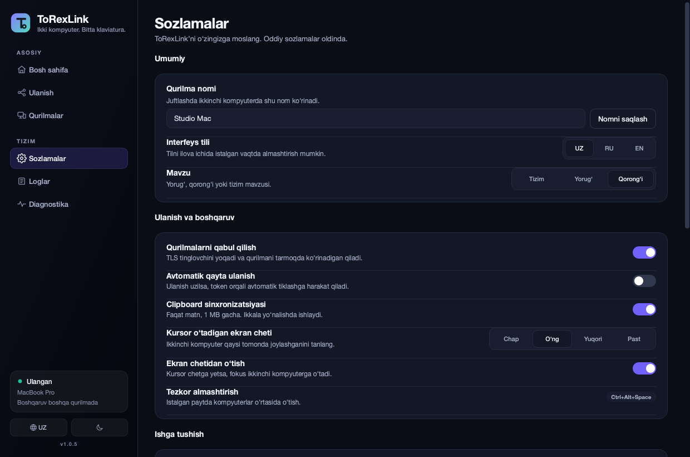
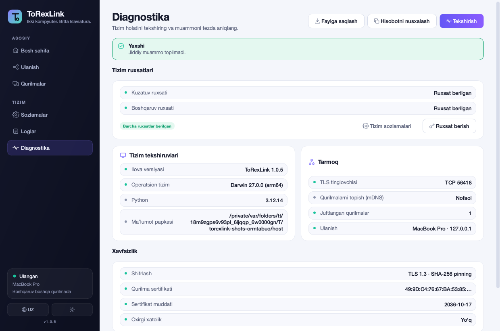
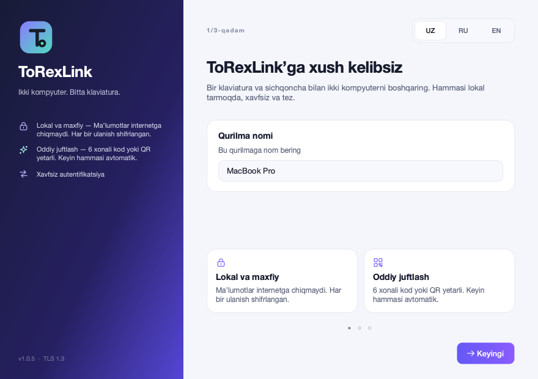

# ToRexLink

**Ikki kompyuter. Bitta klaviatura.**

ToRexLink — Windows va macOS uchun xavfsiz, yengil KVM (keyboard-video-mouse)
dasturi. Bitta jismoniy klaviatura va sichqoncha bilan ikkita kompyuterni
boshqaradi, matnli clipboardni sinxronlaydi va mDNS orqali qurilmalarni
avtomatik topadi.



| Juftlash | Sozlamalar (dark) |
|---|---|
|  |  |

| Diagnostika | Birinchi ishga tushish |
|---|---|
|  |  |

## Imkoniyatlar

- **Host / Guest rejimi** — bitta tugma bilan kod yarating yoki mavjud
  kompyuterga ulaning.
- **6 xonali kod yoki QR orqali juftlash** — kod 3 daqiqa amal qiladi,
  5 urinish bilan cheklangan. QR to‘g‘ridan-to‘g‘ri kameradan yoki rasm
  faylidan skanerlanadi.
- **Token orqali avtomatik qayta ulanish** — juftlik bir marta tasdiqlanadi;
  keyingi ulanishlar 256-bitli token va pinned sertifikat orqali bo‘ladi.
- **Kursor fokusi** — kursor ekran chetidan o‘tadi yoki `Ctrl+Alt+Space`;
  faol bo‘lmagan kompyuterda kursor yashiriladi va qotiriladi
  bilan kompyuterlar almashadi. Ikkala kompyuterning ham klaviaturasi va
  sichqonchasi boshqaruvni o‘z zimmasiga olishi mumkin.
- **TLS 1.3** — faqat TLS 1.3, SHA-256 sertifikat fingerprinti pinlanadi,
  CPace PAKE orqali 6 xonali kod hech qachon ochiq holda yuborilmaydi.
- **mDNS** — `_torexlink._tcp.local.` orqali LAN qurilmalarini topish;
  manzil o‘zgarsa mDNS va QR yangilanadi.
- **Clipboard** — faqat matn, ikki yo‘nalishda, 1 MB gacha, loop himoyasi bilan.
- **Fon rejimi, avtostart** — macOS menu bar / Windows system tray,
  ixtiyoriy tizim ishga tushishida avtomatik start.
- **Interfeys** — to‘liq o‘zbekcha (asosiy), ruscha va inglizcha; til va
  light/dark mavzuni ilova ichida almashtirish.
- **Diagnostika va loglar** — ruxsatlar, TLS, mDNS, firewall va sertifikat
  holati; hisobotni nusxalash yoki faylga saqlash.
- **Windows Firewall** — foydalanuvchi tasdiqlagandan keyin faqat kerakli
  portlar uchun UAC orqali qoida qo‘shish.
- **Xavfsiz saqlash** — tokenlar va sertifikatlar faqat foydalanuvchi uchun
  o‘qiladigan (0600) fayllarda, hech qachon logga yozilmaydi.

## Tez boshlash (manbadan)

Talablar: **Python 3.11+** (build uchun 3.12 tavsiya etiladi), Windows 10/11
yoki macOS. Ikki kompyuter bir xil ishonchli lokal tarmoqda bo‘lishi kerak.

```bash
git clone <repository> ToRexLink
cd ToRexLink
python3.12 -m venv .venv
source .venv/bin/activate          # Windows: .venv\Scripts\activate
pip install -r requirements.txt
python -m torexlink
```

macOS’da dastlabki ishga tushishda tizim ruxsatlari so‘raladi:

1. **Input Monitoring** — fizik klaviatura/sichqoncha eventlarini kuzatish.
2. **Accessibility** — kursor va klaviatura eventlarini boshqa kompyuterga
   uzatish.
3. QR skanerlash uchun ixtiyoriy **Camera** ruxsati.

Ruxsatdan keyin ilovani **qayta ishga tushiring**. Ruxsat oynalarini
**Sozlamalar → Tizim ruxsatlari** yoki **Diagnostika** bo‘limidan qayta ochish
mumkin.

### Juftlash

1. Ikkala kompyuterda ToRexLink’ni ishga tushiring.
2. Birinchi kompyuterda **Ulanish → Bu kompyuterni ulash**ni bosing.
3. Ekranda 6 xonali kod va QR paydo bo‘ladi.
4. Ikkinchi kompyuterda:
   - yaqin atrofdagi qurilmani tanlab kodni kiriting; yoki
   - **Kod bilan ulanish** orqali IP va kodni kiriting; yoki
   - **QR orqali** host ekranidagi QR’ni skanerlang.
5. Juftlash tugagach ulanish avtomatik boshlanadi.

### Boshqaruv

- Aktiv kompyuterdan ikkinchisiga o‘tish uchun sichqonchani tanlangan ekran
  chetiga olib boring yoki `Ctrl+Alt+Space` bosing.
- Qaytish uchun xuddi shu tugmani bosing, qarama-qarshi chetga o‘ting yoki
  boshqa kompyuterning klaviatura/sichqonchasini qo‘zg‘ating — u boshqaruvni
  darhol o‘ziga oladi.
- Fokus qaysi qurilmada ekani ilovadagi sariq banner, menu bar tooltip va
  bildirishnomalarda ko‘rinadi.
- `Ctrl+Alt+Space` global issiq tugma bo‘lib, u faqat ulanish faol bo‘lganda
  ishlaydi.

### Clipboard

Faol ulanish mavjud bo‘lsa, 1 MB gacha bo‘lgan matn avtomatik sinxronlanadi.
Maxfiy ma’lumotlar (masalan, parollar) clipboard orqali tarqalishini
istamasangiz, uni **Sozlamalar → Clipboard sinxronizatsiyasi** orqali
o‘chiring.

## MacOS ruxsatlari

| Ruxsat | Nima uchun | Qayerda |
|---|---|---|
| Input Monitoring | Fizik HID eventlarini o‘qish | System Settings → Privacy & Security → Input Monitoring |
| Accessibility | CGEvent orqali klaviatura/sichqoncha yuborish | System Settings → Privacy & Security → Accessibility |
| Camera (ixtiyoriy) | QR skanerlash | System Settings → Privacy & Security → Camera |
| Local Network | mDNS va LAN ulanishlari | System Settings → Privacy & Security → Local Network |

Ruxsatlar macOS TCC tomonidan ilova imzosi va bundle ID’ga bog‘lanadi.
Developer ID bilan imzolanmagan yoki har safar qayta imzolanadigan build’da
ruxsat qayta so‘ralishi mumkin. Bu — macOS xavfsizlik modeli; ilova buni
chetlab o‘ta olmaydi.

## Windows

- Klaviatura/sichqoncha uchun qo‘shimcha ruxsat talab qilinmaydi
  (low-level hooks + `SendInput`).
- LAN ulanishlari uchun Windows Firewall sozlamasi **Sozlamalar** yoki
  **Diagnostika** bo‘limidagi tugma orqali, foydalanuvchi roziligi va UAC
  bilan amalga oshiriladi. Faqat TCP `48620–48629` va mDNS UDP `5353`
  portlari `private,domain` profillari uchun ochiladi.
- Secure Desktop (UAC oynasi, Ctrl+Alt+Del, lock screen) boshqa kompyuterdan
  boshqarilmaydi — bu Windows’ning xavfsizlik chegarasi.

## Yig‘ish

To‘liq ko‘rsatmalar: [`docs/BUILDING.md`](docs/BUILDING.md).

```bash
# macOS
./scripts/build_macos.sh              # dist/ToRexLink.app
CODESIGN_IDENTITY="Developer ID Application: ..." MAKE_DMG=1 ./scripts/build_macos.sh

# Windows PowerShell
.\scripts\build_windows.ps1           # dist\ToRexLink\ToRexLink.exe
```

Oldindan yig‘ilgan `.app`/`.exe` ushbu repoda saqlanmaydi. Build Windows
uchun Windows mashinasida, macOS uchun macOS mashinasida bajarilishi kerak —
PyInstaller kross-kompilyatsiyani qo‘llamaydi.

## Hujjatlar

- [Foydalanuvchi qo‘llanmasi (UZ)](docs/USER_GUIDE_UZ.md)
- [Arxitektura](docs/ARCHITECTURE.md)
- [Xavfsizlik modeli](docs/SECURITY.md)
- [Protokol spetsifikatsiyasi](docs/PROTOCOL.md)
- [Yig‘ish va ishga tushirish](docs/BUILDING.md)
- [Testlash / QA](docs/TESTING.md)
- [Muammolarni bartaraf etish](docs/TROUBLESHOOTING.md)

## Testlar

```bash
python -m pytest -q
```

Joriy holat: **48 ta test** muvaffaqiyatli (crypto, TLS handshake, CPace,
pairing, auth, focus arbitration, clipboard, settings, mDNS payload, UI
smoke). Batafsil: [`docs/TESTING.md`](docs/TESTING.md).

## Arxitektura

```
torexlink/
├── security/       CPace P-256, sertifikat identity, token HMAC auth
├── protocol/       length-prefixed JSON framing, handshake, validatsiya
├── core/           async xizmat: server, client, pairing, auth, focus,
│                   clipboard, mDNS, session, state
├── input/          platform-neutral eventlar + native backendlar:
│                   macOS Quartz, Windows low-level hooks/SendInput
├── platform/       ruxsatlar, autostart, Windows Firewall, diagnostika
├── ui/             PySide6 premium UI, i18n, theme, dialogs, pages
├── i18n.py         UZ / RU / EN kataloglari
├── app.py          kirish nuqtasi, single-instance, tray, onboarding
└── resources/      logo/icon
```

Batafsil: [`docs/ARCHITECTURE.md`](docs/ARCHITECTURE.md), protokol:
[`docs/PROTOCOL.md`](docs/PROTOCOL.md), xavfsizlik:
[`docs/SECURITY.md`](docs/SECURITY.md).

## Cheklovlar

- Bitta asosiy monitor har bir qurilmada (multi-monitor layout hozircha yo‘q).
- Tarmoq IPv4 asosida ishlaydi; IPv6 listener hozircha yo‘q.
- Klaviatura mappingi fizik US-joylashuvga asoslangan; murakkab IME/kompozitsiya
  va ba’zi maxsus media tugmalari qo‘llanmaydi. Matn uchun clipboard’dan
  foydalaning.
- macOS Secure Input maydonlari (parol oynalari), Windows Secure Desktop,
  lock/login ekranlari boshqarilmaydi.
- File transfer, audio va video uzatish kiritilmagan.
- macOS prebuilt Qt 6.12 uchun macOS 14+ talab qilinadi.
- Windows backend ushbu loyihada macOS muhitida statik tekshirilgan; yakuniy
  QA Windows 10/11 qurilmasida o‘tkazilishi shart (checklist
  [`docs/TESTING.md`](docs/TESTING.md)).
- mDNS ishlamaydigan tarmoqlarda IP orqali qo‘lda ulanish mavjud.

## Litsenziya

Proprietary. Batafsil: [`LICENSE`](LICENSE).
