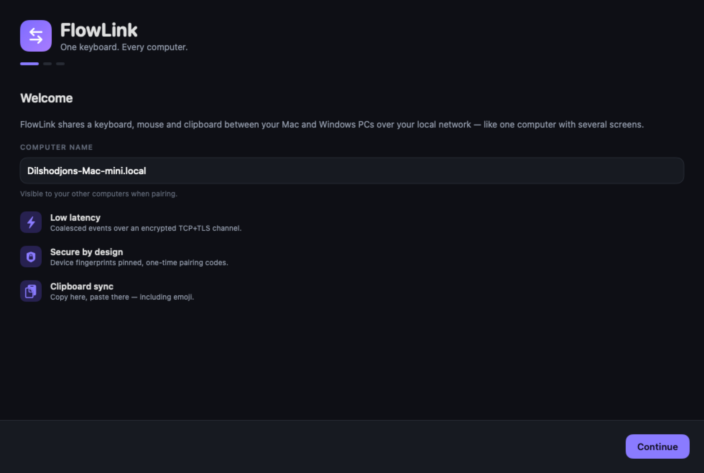
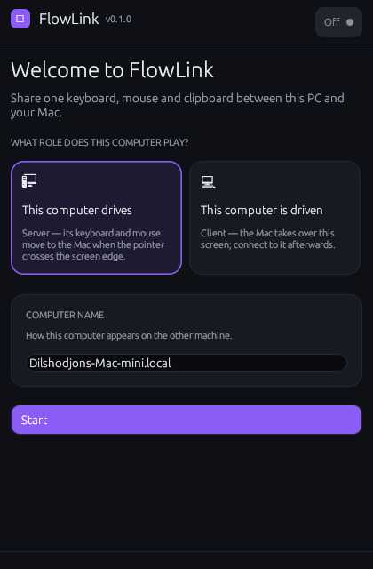
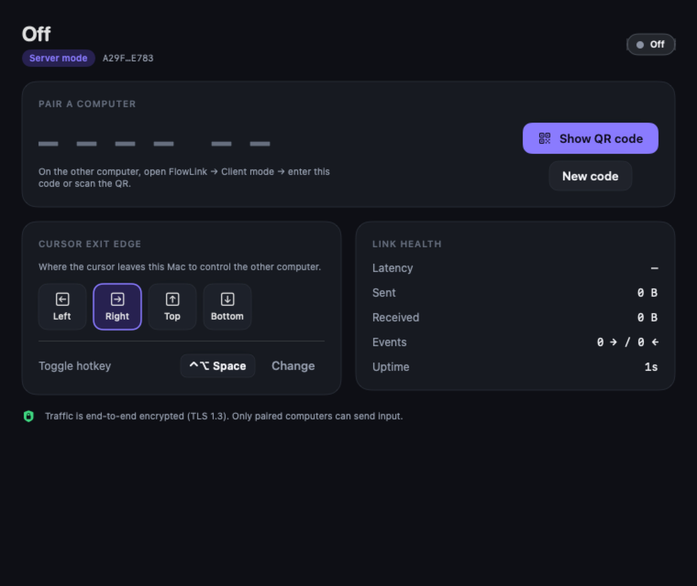
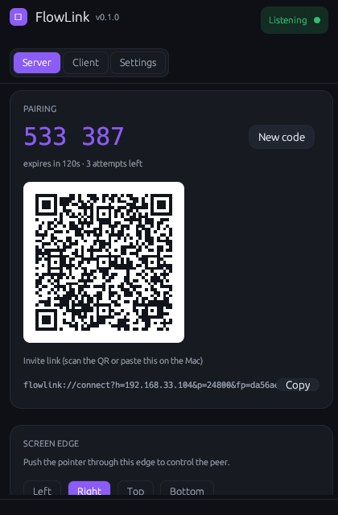
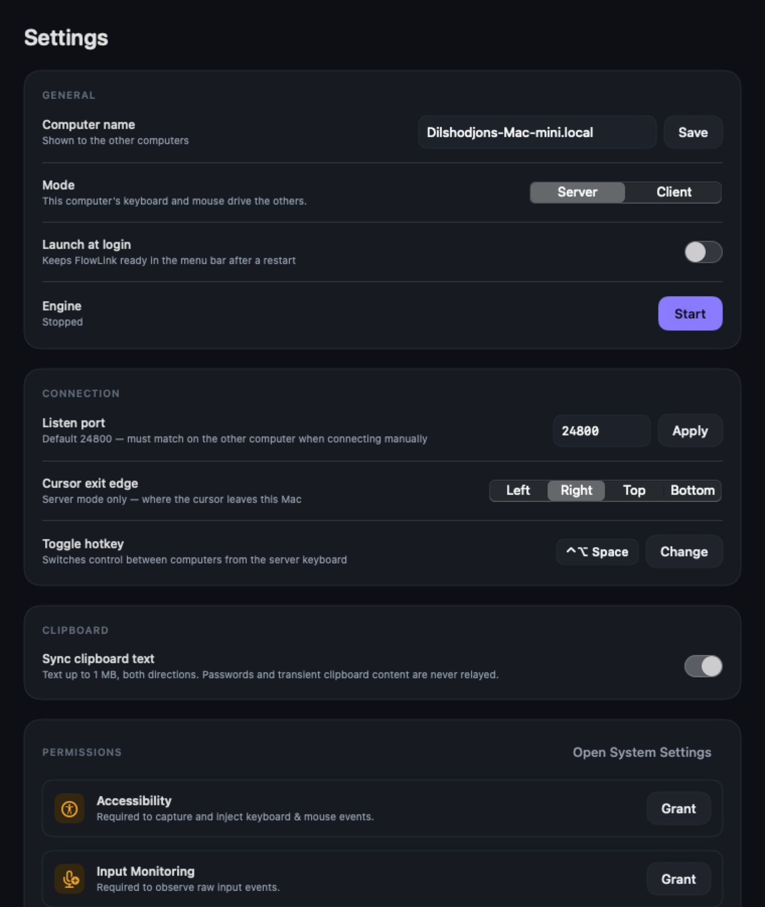
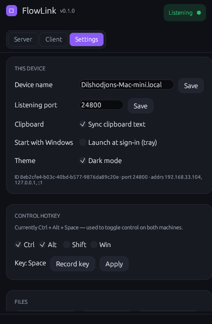
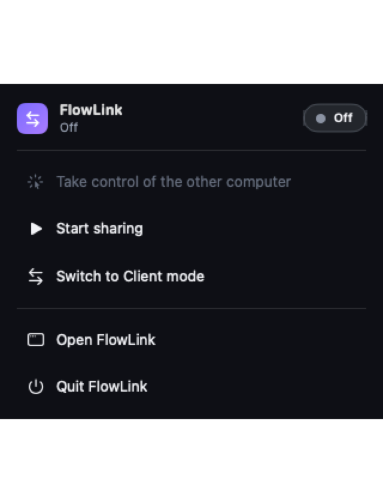
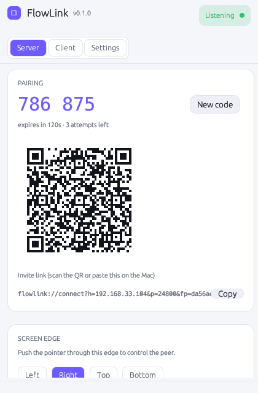

# FlowLink

FlowLink shares one keyboard, mouse and clipboard between a macOS and a
Windows computer over the local network: the server drives, the client is
driven, and the cursor crosses between them when it leaves the configured
screen edge. One Rust core (`flowlink-core`) implements the wire protocol,
encrypted transport, pairing and discovery; native shells (Swift/SwiftUI on
macOS, Win32/egui on Windows) capture and inject input and render the UI.

## Features

- **Server and client modes** — a role per installation, switchable at any
  time from Settings; switching restarts the listener/dialer automatically.
- **Connect any way you like** — mDNS auto-discovery of servers on the LAN,
  manual IP/port entry, scanning the server's QR code, or pasting a
  `flowlink://connect?...` link.
- **Encrypted channel** — TCP + TLS 1.3 (rustls), self-signed per-install
  identities, SHA-256 fingerprints pinned after first pairing (TOFU), 6-digit
  one-time pairing codes.
- **Clipboard text sync, both directions** — up to 1 MiB, echo-suppressed;
  concealed and transient pasteboard types (password managers) are never
  relayed.
- **Automatic reconnect** — jittered exponential backoff (250 ms–15 s) and
  heartbeats every 1 s; a silent peer is declared dead after 6 s.
- **Menu bar / tray UI** — status, pairing code and QR, connect/disconnect,
  toggle control, settings, log viewer.
- **Launch at login** — `SMAppService` on macOS, HKCU Run key on Windows.
- **File logs** — daily-rotated `flowlink.log.<date>` with an in-app viewer.

## Screenshots

Both shells implement the same design system (violet accent, light/dark
palettes, rounded cards, uppercase section headers). Windows previews are
rendered by the cross-platform egui build (see docs/BUILD.md, "UI preview
mode"); macOS previews come from the app's built-in snapshot mode
(`FLOWLINK_SNAPSHOT_DIR`).

| | |
| --- | --- |
|  |  |
|  |  |
|  |  |
|  |  |

## Repository layout

```
Control/
├── rust/                          Cargo workspace
│   ├── Cargo.toml                 workspace deps, version, release profile
│   └── crates/
│       ├── flowlink-core/         engine, protocol, TLS, pairing, discovery
│       ├── flowlink-ffi/          C ABI (flowlink.h) for the macOS app
│       └── flowlink-win/          Windows shell (Rust + Win32/egui/tray)
├── macos/                         SwiftPM package
│   ├── Package.swift              FlowLinkKit + FlowLink app + CFlowLinkCore
│   ├── Sources/CFlowLinkCore/     C module map around flowlink.h
│   ├── Sources/FlowLinkKit/       app model, event tap, injector, views
│   └── Tests/FlowLinkTests/
├── scripts/                       build-macos.sh, test.sh, Info.plist, icon
├── docs/                          ARCHITECTURE, PROTOCOL, SECURITY, …
└── .github/workflows/ci.yml
```

## Quick start (macOS)

Requirements: Xcode (full toolchain — SwiftUI macros need its plugin) or
CommandLineTools, plus Rust via [rustup](https://rustup.rs).

```sh
./scripts/build-macos.sh          # add --debug for a debug build
open dist/FlowLink.app
```

The script builds the Rust static library (`MACOSX_DEPLOYMENT_TARGET=13.0`),
copies it into `macos/Vendor`, runs `swift build`, and assembles
`dist/FlowLink.app` with `Info.plist`, a generated icon and an ad-hoc
signature. If `xcode-select` points at the Command Line Tools but Xcode is
installed too, point Swift at Xcode explicitly:

```sh
DEVELOPER_DIR=/Applications/Xcode.app/Contents/Developer ./scripts/build-macos.sh
```

First run shows an onboarding flow. Grant **Accessibility** (capture and
inject events) and **Input Monitoring** (observe raw input) in System
Settings → Privacy & Security; the app links straight to the right panes and
re-detects grants while it runs.

## Quick start (Windows)

Requirements: Rust via rustup on Windows, and VS Build Tools (MSVC) for the
`windows` crate. Run from the `rust` directory:

```powershell
cargo build --release -p flowlink-win
.\target\release\flowlink-win.exe
```

See [docs/BUILD.md](docs/BUILD.md) for details, including the note about
elevated windows.

## First connection

1. On the server, open FlowLink — it starts listening on TCP port 24800 (configurable)
   and shows a 6-digit pairing code, valid for 120 s, plus a QR code.
2. On the client, either pick the server from the discovered list, enter
   `host:port` manually, scan the QR code, or paste a link, e.g.
   `flowlink://connect?h=192.168.1.24&p=24800&fp=<fingerprint>&c=123456`.
3. Type or scan the code. Both devices now remember each other: the server
   stores an entry with a 32-byte token, the client stores the token in
   `last_server`, and later connections authenticate silently.
4. Move the cursor across the configured edge (default: right) or press the
   hotkey **Ctrl+Alt+Space** to toggle control. On the client, pushing the
   cursor back over the entry edge returns control.
5. Text copied on one side appears on the other side's pasteboard
   (≤ 1 MiB, concealment types excluded).

Devices are remembered by device id plus shared token; "Forget" in Settings
deletes the entry and requires pairing again.

## Testing

```sh
./scripts/test.sh     # cargo test --workspace && (cd macos && swift test)
```

`cargo test --workspace` runs per-module unit tests plus the end-to-end
suite `rust/crates/flowlink-core/tests/e2e_pairing.rs`, which boots two real
engines on loopback with TCP+TLS, pairs them with a code, relays input and
clipboard, reclaims control and reconnects with the stored token. CI runs the
Rust tests on macOS and Windows, builds/tests the Swift package and both app
artifacts (see [docs/BUILD.md](docs/BUILD.md#ci)).

## Security summary

- TLS 1.3 with self-signed ECDSA P-256 identities; SHA-256 fingerprint
  pinning on every reconnect; a fingerprint mismatch aborts before any
  secret is sent.
- TOFU on first contact, gated by a 6-digit, single-use pairing code that is
  shown only on the server screen (TTL 120 s, 3 attempts, then auto-rotation).
- Pairing exchanges a 32-byte random token, stored `0600` in the config
  directory (`0700`); later connections compare it in constant time.
- Clipboard relay is text-only and size-limited; no keys or clipboard
  contents are ever written to the logs.

Details, threat model and explicit non-goals: [docs/SECURITY.md](docs/SECURITY.md).

## Status

v1 targets macOS 13+ (server or client) and Windows 10+ (server or client),
one active client per server. Deliberately not included: clipboard images,
audio/notification sync, Linux/Wayland shells, and forwarding physical input
from the client back to the server (single-master). Platform quirks — secure
input fields, UIPI, mixed-DPI feel, keyboard layouts — are documented in
[docs/PLATFORM-LIMITS.md](docs/PLATFORM-LIMITS.md).

## Documentation

| Document | Contents |
| --- | --- |
| [docs/ARCHITECTURE.md](docs/ARCHITECTURE.md) | Layering, engine internals, threading, storage, tests |
| [docs/PROTOCOL.md](docs/PROTOCOL.md) | Framing, handshake, message and event tables, discovery, links |
| [docs/SECURITY.md](docs/SECURITY.md) | Threat model, pairing, pinning, limitations |
| [docs/PLATFORM-LIMITS.md](docs/PLATFORM-LIMITS.md) | macOS/Windows/cross-platform constraints, comparison |
| [docs/BUILD.md](docs/BUILD.md) | Prerequisites, builds, CI, release checklist |
| [docs/QOLLANMA.md](docs/QOLLANMA.md) | O‘zbekcha o‘rnatish va foydalanish qo‘llanmasi |
